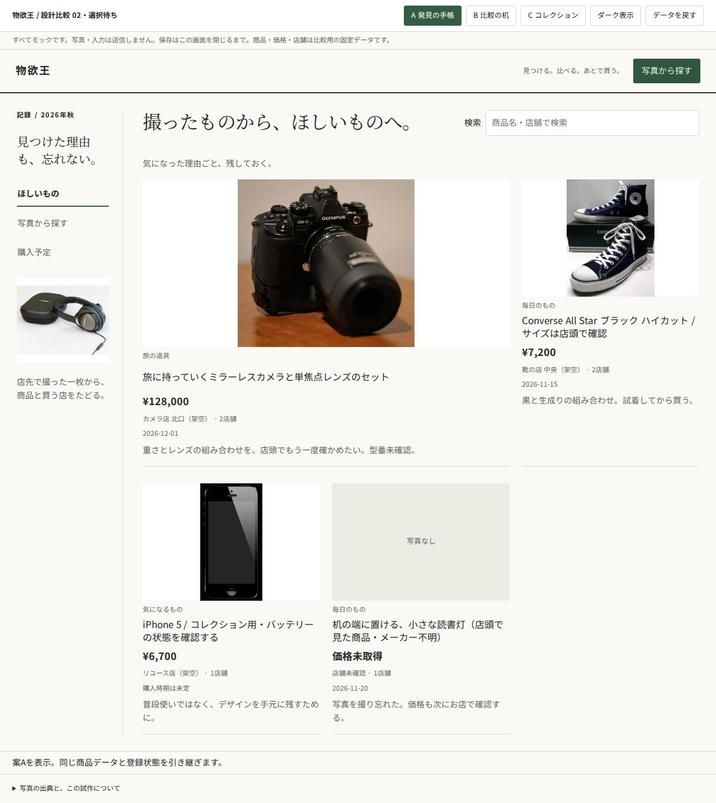
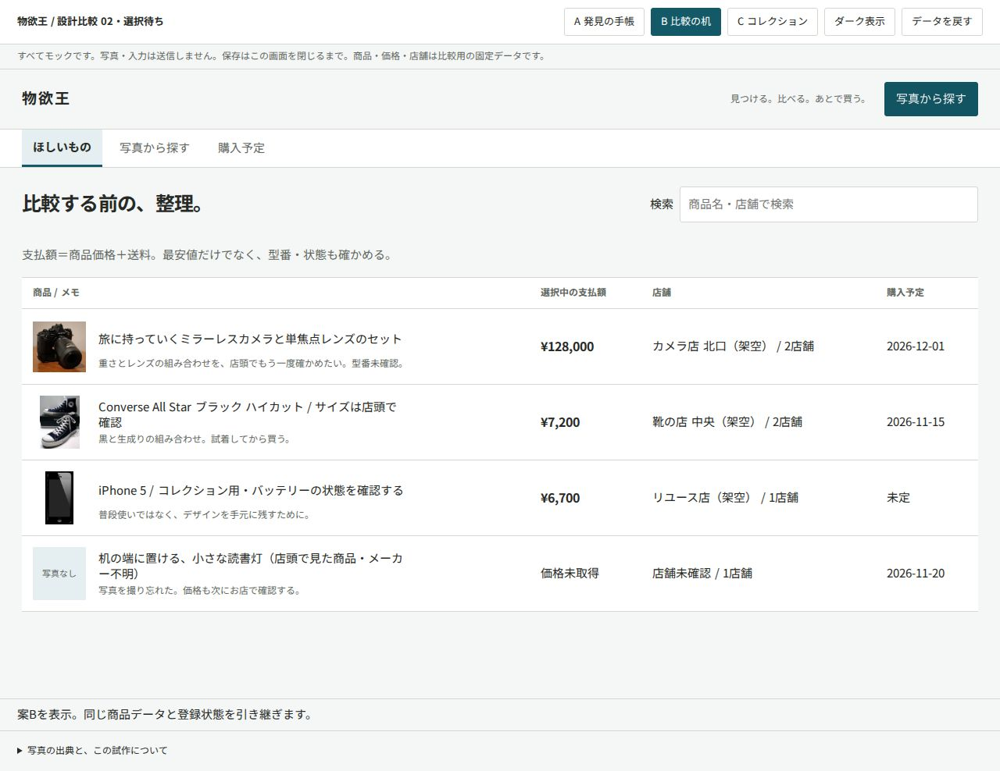
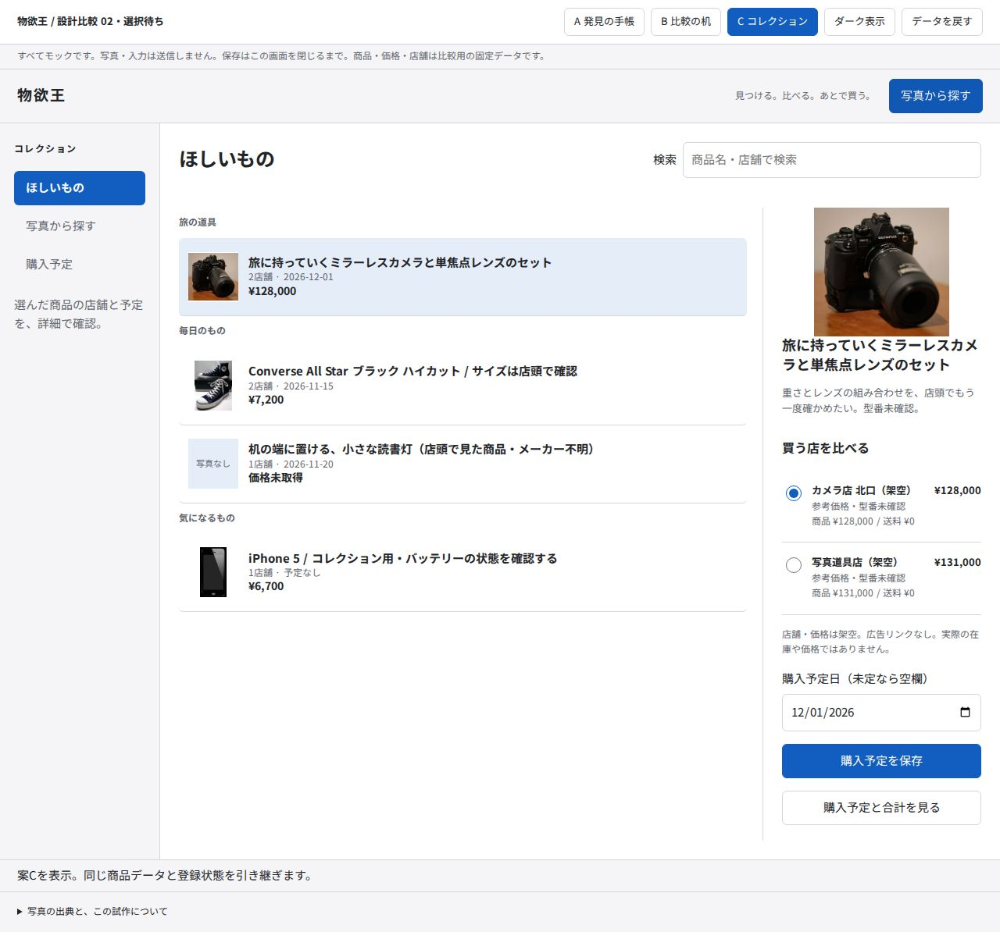
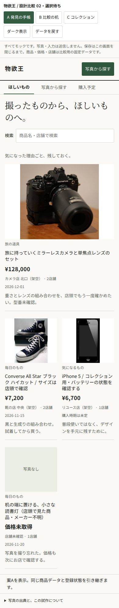
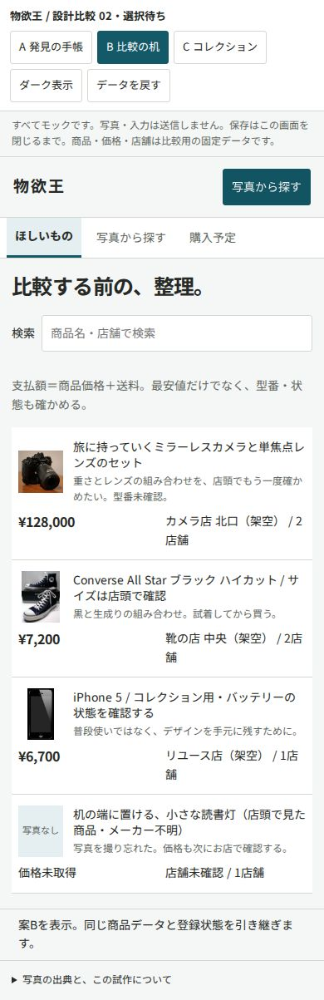
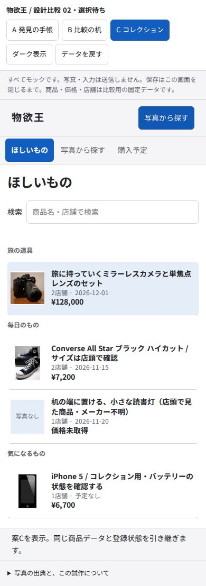

# 物欲王 UI再提案 — 3つの操作構造

**選択待ち。PR #257はDraft・未マージです。推薦は採用の決定ではありません。**

## 開き方

[操作できる3案（prototypes.html）](prototypes.html) をGitHubの「Download raw file」で保存し、ブラウザで開いてください。画像・CSS・JavaScriptを内包した1ファイルで、サーバーやAPIキーは不要です。GitHub上のソース表示自体は実行プレビューではありません。公開ホスティングは追加していません。

上部のA/B/Cで案を切り替えられます。商品データと登録状態は共通です。最初から比較するときは「データを戻す」を押してください。保存はページ内のメモリーだけで、再読み込みすると初期状態に戻ります。

[全画面のスクリーンショット一覧](screenshots.md) / [調査と設計の根拠](research.md) / [検証・レビュー](validation.md)

## 3案の比較

| | A 発見の手帳 | B 比較の机 | C コレクション |
|---|---|---|---|
| 入口 | 写真と「欲しい理由」を眺める | 商品・支払額・店舗・予定を一覧で照合 | 用途別リストから1商品を選ぶ |
| デスクトップ | 左に記録の案内、右に大小の写真とメモ | 横長の一覧表。候補・店舗は項目を揃えて比較 | 左ナビ、中央の選択リスト、右の詳細 |
| 写真から登録 | 元写真を残したページで候補を見比べ、そのまま登録 | 候補ごとの特徴・参考価格・未確認事項を並列に読む | 写真選択→候補比較→登録確認のシート |
| 店舗比較 | 写真の隣で店舗の条件を読む | 価格・送料・支払額・状態の比較表 | 選択した商品の詳細で店舗と予定を扱う |
| スマートフォン | 写真を中心に縦へ読み進む | 一覧を2段の行、店舗比較は2列に縮める | 一覧→詳細の画面遷移。写真登録は段階表示 |
| 利点 | 店頭で見つけた理由や記憶が残りやすい | 費用差と条件差を一度に確認しやすい | 日常の整理と写真登録の判断を分けやすい |
| 弱点 | 多件数では縦に長くなる | 写真を楽しむ余地が少なく、小画面では情報が密 | 写真の印象はAより弱く、段階分のクリックが増える |
| 前回からの変更 | 共通リストの装飾替えから、記録と写真を読むページへ | 密度変更だけでなく、候補の根拠と店舗の比較軸を固定 | 白いカードの一覧から、選択状態と詳細の階層へ |

### デスクトップの一覧

| A | B | C |
|---|---|---|
|  |  |  |

### スマートフォンの一覧

| A | B | C |
|---|---|---|
|  |  |  |

## 推薦：C コレクション

日常の一覧では商品を選ぶことに集中し、選択した商品の店舗・購入予定を詳細へ分ける構成を推薦します。写真からの登録では「推定」「候補の選択」「登録内容の確認」を別の段階に置けるため、AIの推定が確定情報に見える危険を抑えられます。

Appleから取り入れたのは、Photosのサイドバーとコンテンツの分離、Remindersのカテゴリ見出しとリスト、選択状態を保ちながら詳細へ進む考え方です。ぼかしやガラス表現は使っていません。詳細ペインと3段階の写真シートは物欲王のための設計判断で、Apple純正画面をそのまま再現したものではありません。

写真を眺める時間を最優先するならA、購入直前の価格・店舗比較を最優先するならBが適します。**いずれも実アプリへの採用は未決定です。**

## 試してほしい操作（各案で共通）

1. 「読書灯」で検索し、画像なし・価格未取得の表示を確認。存在しない名前で0件も確認。
2. 「写真から探す」で写真を選ぶか、「サンプル写真を使う」を押す。選んだ写真は送信しません。
3. QC25とQC35 IIを比較。型番未確認の表示を読み、QC25を選んで登録。Cだけ登録前に確認画面があります。
4. 登録後、2店舗の条件を比較。リユース音楽店を選ぶと商品¥17,400＋送料¥600＝¥18,000になります。
5. 購入予定を2026-11-25で保存し、予定画面へ。既存2商品の¥135,200と合わせて**¥153,200**、価格未取得1件は合計対象外です。
6. Tab・Enter・Spaceで選択し、Cの写真画面をEscapeで閉じる。表示幅を狭くし、ダーク表示も試してください。

## モックと実アプリの境界

- 3案の検索・写真選択・候補・登録・店舗比較・購入予定はすべて固定データのモックです。実アプリのDBやAPIには接続しません。
- 入力写真に関係なく候補は同じです。認識精度・検索順位の改善を示すものではありません。ファイル名は候補生成に使いません。
- 店舗、価格、在庫・状態は架空です。同一商品未確認の表示を登録後も残しています。広告リンクはありません。
- Wikimedia Commonsの参考写真を前回案から再利用。出典・作者・ライセンスはHTML末尾に保持しています。
- この再提案では新しい案を `src/` に実装していません。#257に以前からあるC案の実装差分は、旧提案としてDraft内に残っています。新しいCを採用済みとする意味ではありません。
- #258・#259を含む `82cc6ad` をこのブランチへ取り込みました。写真評価・一覧取得の処理を今回の試作で置き換えていません。本番変更・マージ・デプロイはしていません。

## 次に決めること

A/B/Cのどの操作構造を基準に実アプリへ反映するか。選択後、URL登録、写真登録、比較グループ、複数選択、購入済みなどの既存機能を維持して本実装へ進めます。今回のプロトタイプはその選択のためのものです。
